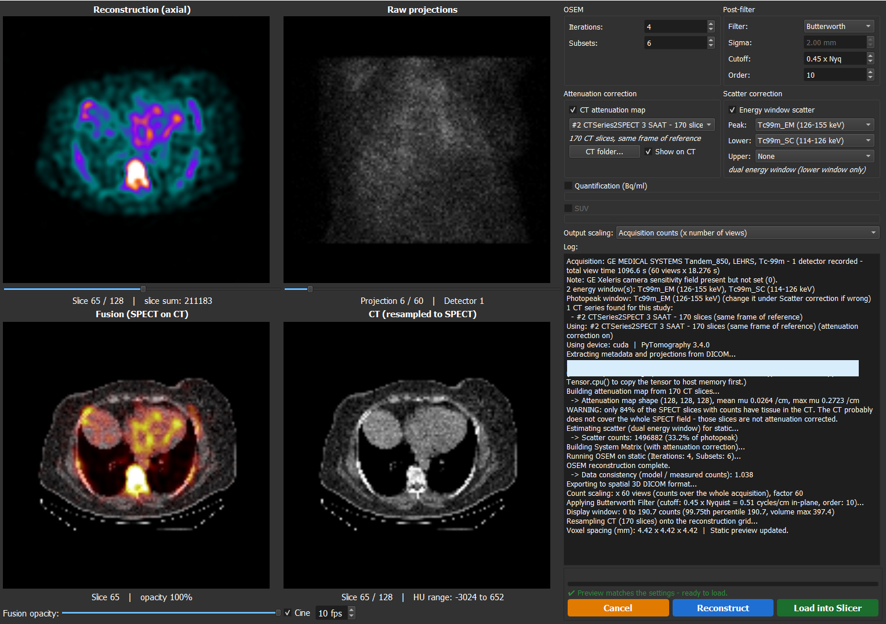
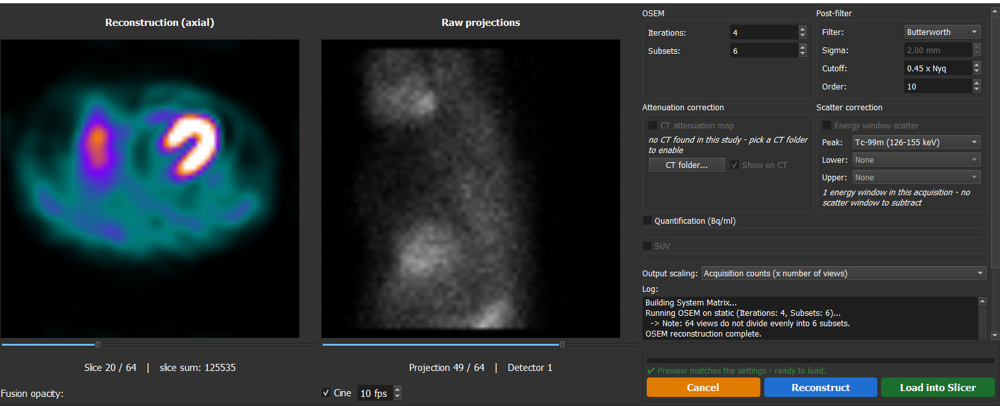

# DICOM SPECT Reconstruction (3D Slicer)

Reconstructs SPECT studies straight from the raw NM tomographic projections in Slicer's DICOM browser.
The projection series (ImageType TOMO or GATED TOMO) shows up as a loadable, and Load opens a
reconstruction window with a live preview before anything is added to the scene.

Author: Burak Demir, MD, FEBNM

> **Built on [PyTomography](https://github.com/qurit/PyTomography).** The reconstruction engine of this
> extension - the SPECT system model, attenuation and scatter modelling, and OSEM - is PyTomography,
> developed by the [Quantitative Radiomolecular Imaging and Therapy (Qurit) lab](https://www.qurit.ca/).
> This extension adds the Slicer side: DICOM browsing, CT matching, the preview window and quantification.
> If you use it in your work, please also cite PyTomography:
>
> L. Polson, R. Fedrigo, C. Li, M. Sabouri, O. Dzikunu, S. Ahamed, N. Karakatsanis, S. Kurkowska,
> P. Sheikhzadeh, P. Esquinas, A. Rahmim, C. Uribe. *PyTomography: A Python Library for Medical Image
> Reconstruction.* SoftwareX. Preprint: [arXiv:2309.01977](https://arxiv.org/abs/2309.01977).



## Features

- **OSEM** reconstruction with [PyTomography](https://github.com/qurit/PyTomography), with separate
  iterations/subsets for the static and the gated images.
- **CT attenuation correction**: a CT of the same study (same frame of reference) is found
  automatically, or picked from a folder; it is also shown fused with the SPECT.
- **Scatter correction** with dual or triple energy windows, chosen from the acquisition's windows.
  The dual window weight is automatic (0.5 x photopeak width / lower window width) or can be set
  by hand, e.g. 1.1 to match GE Xeleris' "Scatter weight for Tc99m".
- **Gated studies**: gated reconstruction in cine plus the summed static image; gates are loaded as a
  sequence. The ECG gating information of the acquisition is kept on the volumes (`SPECTRecon.Gating*`
  attributes): accepted R-R window, accepted and rejected beats, heart rate / mean R-R (estimated from the
  frame time when the scanner leaves it out), frame width, framing and beat rejection settings, and the
  per-view values when the scanner stores one entry per projection view (Mediso), plus the photopeak
  projection counts of every gate (`SPECTRecon.GatePhotopeakCounts`), used by the Gated QC step of the
  Myocardial Perfusion SPECT extension.
- **Post-filters** (Butterworth, Hann, Gaussian with FWHM in mm) and output count scaling.
- **Quantification (optional)**: with a calibration factor (cps/MBq) made in the **SPECT Calibration**
  module, the static image is converted to Bq/ml and optionally to SUV:
  `Bq/ml = acquisition counts / (T x CF) x 1e6 / voxel volume (ml)`, where T is the total view time.
  Calibrations are kept in a JSON library that can live on a shared drive.



## Use

1. Import the study into the DICOM database and select the NM SPECT series.
2. Load opens the reconstruction window: projections in cine, reconstruction and CT fusion previews,
   and the settings (OSEM, attenuation, scatter, filter, scaling, quantification).
3. Press **Reconstruct**, check the preview, then **Load into Slicer**.

### SPECT Calibration module

1. Reconstruct a phantom of known activity with CT attenuation correction (and scatter correction if wanted).
2. In *Nuclear Medicine > SPECT Calibration* pick that reconstruction, choose the VOI (phantom outline
   from CT with a margin, a segment, or the whole image) and enter the activity and times.
3. Compute and save the calibration factor; the reconstruction window then offers it under
   *Quantification*.

## Requirements

PyTorch comes from Slicer's **PyTorch** extension (installed as a dependency, the module offers to install
the right CPU/CUDA build); PyTomography is installed on first use with PyTorch kept at that build.
A GPU makes reconstruction much faster.

## Layout

```
CMakeLists.txt                 extension (depends on the PyTorch extension)
DICOMSpectRecon/
  DICOMSpectRecon.py           hidden module that registers the DICOM plugin
  SPECTCalibration.py          calibration module (Nuclear Medicine category)
  DICOMSpectReconLib/
    nmdata.py                  NM header, energy windows, gating (incl. ECG R-R / beats), CT matching
    reconstruction.py          PyTomography OSEM, count scaling, post-filters
    quantification.py          calibration factors, Bq/ml, SUV, calibration library
    display.py                 in-memory previews
    dialog.py                  reconstruction window
  Resources/Icons/
```

Without building, add the inner `DICOMSpectRecon` folder to *Edit > Application Settings > Modules >
Additional module paths* and restart Slicer.

## Acknowledgements

Reconstruction powered by [PyTomography](https://github.com/qurit/PyTomography) (see the citation at the
top of this page).
